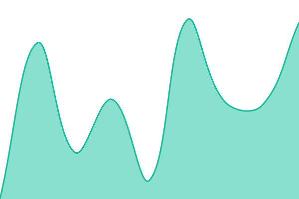

# [📈 Live Status](https://status.agon1230.com): <!--live status--> **🟩 All systems operational**

This repository contains the open-source uptime monitor and status page for [msentell](https://status.agon1230.com), powered by [Upptime](https://github.com/upptime/upptime).

With [Upptime](https://upptime.js.org), you can get your own unlimited and free uptime monitor and status page, powered entirely by a GitHub repository. We use [Issues](https://github.com/msentell/agon-status/issues) as incident reports, [Actions](https://github.com/msentell/agon-status/actions) as uptime monitors, and [Pages](https://status.agon1230.com) for the status page.

<!--start: status pages-->
<!-- This summary is generated by Upptime (https://github.com/upptime/upptime) -->
<!-- Do not edit this manually, your changes will be overwritten -->
<!-- prettier-ignore -->
| URL | Status | History | Response Time | Uptime |
| --- | ------ | ------- | ------------- | ------ |
|  [agon1230.com](https://agon1230.com/) | 🟩 Up | [agon1230-com.yml](https://github.com/msentell/agon-status/commits/HEAD/history/agon1230-com.yml) | 

 281ms
     
 | 

<a href="https://status.agon1230.com/history/agon1230-com">100.00%</a>
    

|  [Server and database](https://agon1230.com/healthz) | 🟩 Up | [server-and-database.yml](https://github.com/msentell/agon-status/commits/HEAD/history/server-and-database.yml) | 

 209ms
     
 | 

<a href="https://status.agon1230.com/history/server-and-database">100.00%</a>
    

|  [Scheduler (prompts, fines, billing)](https://agon1230.com/healthz/scheduler) | 🟩 Up | [scheduler-prompts-fines-billing.yml](https://github.com/msentell/agon-status/commits/HEAD/history/scheduler-prompts-fines-billing.yml) | 

 182ms
     
 | 

<a href="https://status.agon1230.com/history/scheduler-prompts-fines-billing">99.10%</a>
    

|  [Agōn API](https://agon1230.com/v1/openapi.json) | 🟩 Up | [agon-api.yml](https://github.com/msentell/agon-status/commits/HEAD/history/agon-api.yml) | 

 325ms
     
 | 

<a href="https://status.agon1230.com/history/agon-api">100.00%</a>
    

<!--end: status pages-->

[**Visit our status website →**](https://status.agon1230.com)

## 📄 License

- Powered by: [Upptime](https://github.com/upptime/upptime)
- Code: [MIT](./LICENSE) © [Anand Chowdhary](https://anandchowdhary.com)
- Data in the `./history` directory: [Open Database License](https://opendatacommons.org/licenses/odbl/1-0/)
